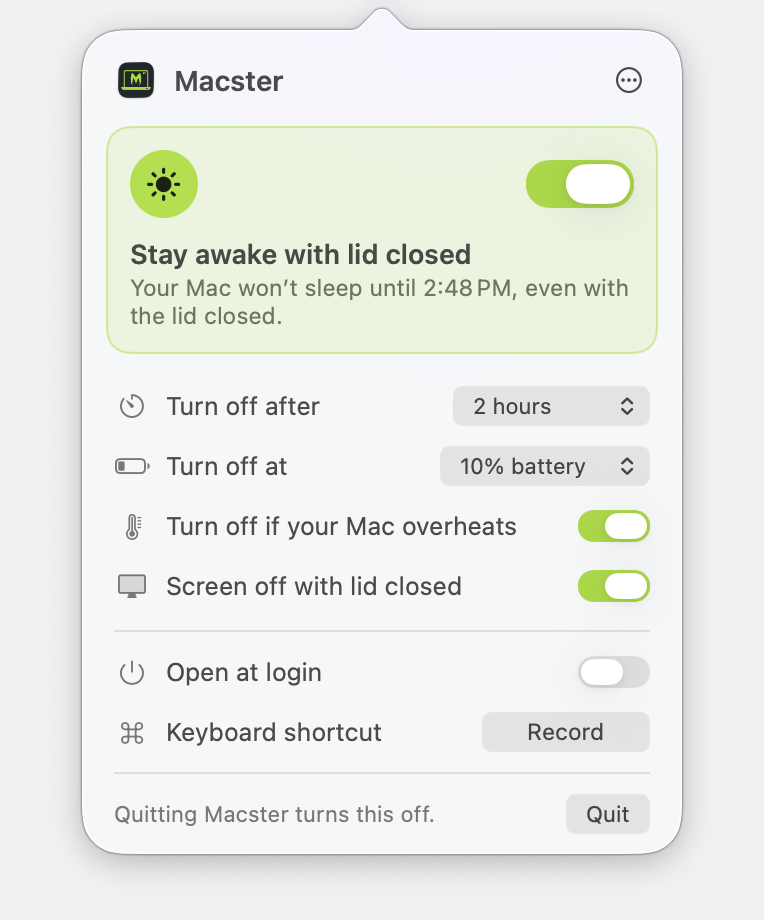

<div align="center">
  

  # Macster

  Keep your Mac awake with the lid closed, from the menu bar.

  [](https://github.com/ApocalixDeLuque/Macster/releases/latest)
  [](https://github.com/ApocalixDeLuque/Macster/actions/workflows/ci.yml)
  [](LICENSE)
  [](https://www.apple.com/macos/)
  [](Package.swift)

  <br>

  
</div>

## Why

Closing a MacBook's lid puts it to sleep. That's usually right, but not when you're downloading something big, running a
long job or an AI agent, connected remotely, or using the Mac closed on a desk. Macster gives you one switch for that,
and it puts everything back the moment you turn it off or quit.

## What it does

Macster changes exactly one system setting: `pmset disablesleep`. While it's on, your Mac doesn't sleep, including when
you close the lid. Everything else stays yours: the display still turns off on your schedule, and your sleep, disk,
standby, and Power Nap settings are never touched.

| | |
| --- | --- |
| **Always visible** | The menu bar icon is a laptop: outlined while your Mac sleeps normally, filled while Macster keeps it awake. Point at it to see when it turns off. |
| **Never left on by accident** | Quitting turns it off. If Macster crashes or is force quit, a tiny watchdog process turns normal sleep back on within a second. If the Mac lost power while it was on, Macster turns it off the next time it opens. |
| **Timers** | Keep awake for 30 minutes up to 8 hours, or until you turn it off. The right-click menu starts a one-off session of any of those lengths without changing your default. |
| **Safety** | Turns itself off at a battery level you choose (10% unless you change it) so your Mac can sleep instead of dying, and when the battery passes 45 °C or macOS reports critical heat, which is what happens in a bag. A notification tells you why. |
| **Screen off when closed** | With sleep disabled, macOS can leave the built-in screen lit behind a closed lid. Macster turns the screen off when you close the lid and back on when you open it, so it doesn't waste battery or heat up. It leaves the screens alone when a monitor is connected. |
| **Keyboard shortcut** | Turn it on and off from any app with a shortcut you record in the panel. |
| **Scriptable** | `macster on 2h`, `macster run -- make release`, and `macster://` URLs for Shortcuts and its automations, Raycast, Alfred, or anything that can open a URL. |
| **Honest state** | Reads the setting straight from the kernel, confirms every change actually took effect, and follows changes made elsewhere, such as in Terminal. |
| **Light** | No network, no analytics, no updater. While off, Macster does nothing until you use it. While on, it checks the battery once a minute. |

## Install

1. Download the latest `Macster-<version>.dmg` from [Releases](https://github.com/ApocalixDeLuque/Macster/releases/latest).
2. Open the DMG and drag `Macster.app` into Applications.
3. Open Macster. Its icon appears in the menu bar.

> [!NOTE]
> Macster is ad-hoc signed, not notarized. If macOS blocks the first launch, open System Settings → Privacy & Security
> and click **Open Anyway**.

The first time, Macster asks for your password once. See [Setup](#setup).

## Use

- **Click** the icon to open the panel, then flip **Stay awake with lid closed**.
- **Right click** the icon for a quick menu: the same switch, **Stay Awake For** 30 minutes to 8 hours, and Quit.
- **Keyboard shortcut**: in the panel, click **Record** next to Keyboard shortcut and press the keys. Use two or more
  modifier keys including ⌘ or ⌃ (like ⌃⌥⌘L), or a function key. Escape cancels; Delete removes the shortcut.
- Turn on **Open at login** if you want the icon there after every restart.

While it's on, the Sleep item in the Apple menu doesn't work either. That's how macOS implements "never sleep".

### Command line

Put the `macster` command on your `PATH` once:

```sh
sudo mkdir -p /usr/local/bin
sudo ln -sf /Applications/Macster.app/Contents/MacOS/Macster /usr/local/bin/macster
```

| Command | |
| --- | --- |
| `macster on [duration]` | Keep the Mac awake. Durations look like `45m`, `2h`, `1h30m`, or `never`. Without one, your **Turn off after** setting applies. |
| `macster off` | Let it sleep normally again. |
| `macster toggle` | Switch between the two. |
| `macster run -- <command>` | Stay awake until `<command>` exits, then turn off. If Macster was already on, it stays on afterwards. The command's exit status passes through. |
| `macster status` | Print `on` or `off`, read from the kernel. |
| `macster open` | Show the panel. |
| `macster diagnose` | Print what Macster sees and what setup would do. Changes nothing. |

The command talks to the menu bar app, starting it if needed, and waits until the kernel confirms the change. If a
safety would stop Macster (low battery, heat), it says so instead of turning on.

### Shortcuts and automation

Macster answers these URLs. In Shortcuts, add an **Open URLs** action with one of them; on macOS 26, a Shortcuts
automation can then run it for you, for example "When my Mac connects to power" → `macster://on`.

| URL | |
| --- | --- |
| `macster://on` | Turn on, with your **Turn off after** setting. |
| `macster://on?minutes=90` | Turn on for 90 minutes (or `hours=2`; `minutes=0` means no timer). |
| `macster://on?pid=4242` | Turn on until process 4242 exits. |
| `macster://off` | Turn off. |
| `macster://toggle` | Switch between the two. |
| `macster://open` | Show the panel. |

From Terminal: `open -g macster://toggle`. A URL never starts setup: if Macster isn't set up yet, it shows its panel.

## Setup

Changing `disablesleep` requires root. Instead of asking for your password every time, setup installs one sudo rule that
lets your account run exactly these two commands without a password, and nothing else:

```text
/usr/bin/pmset -a disablesleep 1
/usr/bin/pmset -a disablesleep 0
```

The rule lives in `/etc/sudoers.d/macster`. It is checked with `visudo` before it goes live and removed again if sudo
rejects it. There is no custom root helper: `pmset` is Apple's own tool, protected by System Integrity Protection.

### Upgrading from Macster 0.1

Version 0.1 changed much more than it needed to: it set display sleep, disk sleep, standby, and Power Nap to 0, ran
`caffeinate` to keep the display on, and installed a root helper at `/usr/local/libexec/macsterctl`. The first time you
open 0.2, setup undoes all of that in the same password prompt:

1. Stops the old `caffeinate` job.
2. Restores the power settings 0.1 saved before changing them (or macOS defaults if it left no backup).
3. Turns normal sleep back on.
4. Deletes the old helper and replaces its sudo rule with the new one.

## Uninstall

1. In the panel, choose **⋯ → Remove Macster's Permission…** (or run `sudo rm /etc/sudoers.d/macster`).
2. Quit Macster and drag it to the Trash.
3. If you added the command: `sudo rm /usr/local/bin/macster`.

## Troubleshooting

`macster diagnose` prints what Macster sees (the kernel's sleep flag, the battery and its temperature, the permission,
leftovers from 0.1) and the exact script setup would run. It changes nothing:

```sh
/Applications/Macster.app/Contents/MacOS/Macster diagnose
```

Macster logs to the unified log under the `io.github.macster` subsystem:

```sh
log stream --level info --predicate 'subsystem == "io.github.macster"'
```

**The login screen appears when you open the lid.** Your Mac didn't sleep. Macster turned the screen off, and macOS
locks when the screen turns off if **Require password after screen saver begins or display is turned off** (System
Settings → Lock Screen) is set to Immediately. Choose a longer delay there if you prefer. To list the times your Mac
really slept:

```sh
pmset -g log | grep "Entering Sleep"
```

## How it works

| Piece | What it does |
| --- | --- |
| `IOPMrootDomain` | Macster reads the kernel's `SleepDisabled` flag directly, with no process launches. A change counts only once the kernel reports it. |
| `sudo -n /usr/bin/pmset -a disablesleep 1/0` | The only privileged commands it runs. `-n` means it never prompts. |
| `com.apple.system.powermanagement.prefschange` | powerd's notification when power settings change, so the icon follows changes made anywhere. |
| `macster-watchdog` | Started just before Macster disables sleep. Macster holds the only write end of its stdin, so if Macster dies for any reason the kernel closes the pipe and the watchdog turns sleep back on. It waits in `kevent` and uses no CPU. |
| `IOPowerSources`, `AppleSmartBattery`, `ProcessInfo.thermalState` | Battery level, battery temperature, and heat, watched only while Macster keeps the Mac awake. The temperature has no change notification, so it's read once a minute. |
| Carbon `RegisterEventHotKey` | The keyboard shortcut. macOS hands Macster only that key combination, so it needs no Accessibility or Input Monitoring permission. |
| `kqueue` process events | `macster run` and `pid=` URLs: the kernel reports when the program exits; nothing polls. |
| `kIOPMMessageClamshellStateChange` | IOPMrootDomain's lid message, watched only while Macster keeps the Mac awake. On close, Macster runs `pmset displaysleepnow` (no root needed); on open, `IOPMAssertionDeclareUserActivity` makes sure the screen comes back. |
| UserNotifications | Provisional authorization: no permission prompt. Notifications arrive quietly in Notification Center, where you can promote or turn them off. |

Macster stores only its preferences (the timer, the battery level, the heat and screen switches, the keyboard
shortcut) in its defaults domain, `io.github.macster.Macster`.

## Limitations

- When the screen turns off with the lid closed, your Mac locks if it's set to require a password after the screen
  turns off, the same as after sleep (see [Troubleshooting](#troubleshooting)). If something has to control the screen
  while the lid is closed (screen recording, an agent that clicks around), turn off **Screen off with lid closed**.
- macOS can still force sleep in a thermal emergency.
- Running with the lid closed in a bag gets hot. Leave the overheating safety on; it reacts within about a minute.
- The keyboard shortcut can't take over shortcuts macOS reserves, such as ⌘Space.
- Shortcuts actions come through URLs. Native Shortcuts actions (App Intents) need Xcode to build.

## Build

Requirements: macOS 14 or newer and Swift 6.2 or newer (Xcode or the Command Line Tools).

| Command | |
| --- | --- |
| `./scripts/test.sh` | Runs the tests. Works with only the Command Line Tools installed. |
| `./scripts/build-release.sh` | Builds `dist/Macster.app` (universal: Apple silicon and Intel), the DMG, the ZIP, and `checksums.txt`. |
| `./scripts/install-local.sh` | Builds for this Mac, replaces `/Applications/Macster.app`, and relaunches it. |
| `swift run MacsterSnapshots /tmp/shots assets/macster.png` | Renders every panel state, light and dark, plus the menu bar icons, to PNG files. |

The code is split into `MacsterCore` (decisions and text that can be tested without touching the system: parsing,
the setup script, the sudo rule, timer, safety, and lid rules, URLs and command-line arguments, shortcuts, sessions),
`MacsterApp` (the state model, system integration, the command-line tool, and the SwiftUI panel), and
`MacsterWatchdog`.

Every push to `main` and every pull request runs the tests and builds the universal app on GitHub Actions.

## Release

1. Set the new version in `VERSION` and add a `## <version>` section to `CHANGELOG.md`.
2. Merge to `main`, then run the release workflow:

   ```sh
   gh workflow run release.yml --repo ApocalixDeLuque/Macster --ref main
   ```

The workflow runs the tests, builds the app, and publishes the DMG, ZIP, and checksums as a GitHub release, with that
version's changelog section as the release notes. It stops before building if the changelog has no section for the
version.

## License

MIT. See [LICENSE](LICENSE).
